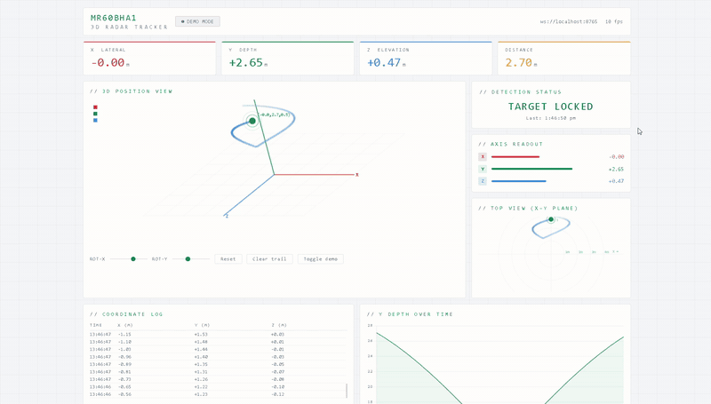

# MR60BHA1 – Live 3D Spatial Tracking

Real-time 3D position tracking of a person using the Seeed **MR60BHA1** 60 GHz mmWave radar and an **ESP32**. The ESP32 decodes the radar's coordinate frames, a Python bridge forwards them over WebSocket, and a browser dashboard shows the target live in 3D with a depth-over-time chart.

```
MR60BHA1 ──UART──► ESP32 ──USB serial──► radar_bridge.py ──WebSocket (8765)──► dashboard/index.html
```

## Demo



> **Demo video: simulated data.** This clip shows the dashboard running in the bridge's demo mode (no sensor attached), so the motion is generated, not a real person. [Full-quality video](docs/dashboard-demo.mp4).

## Repository layout

```
mr60bha1-3d-tracking/
├── firmware/
│   └── mr60bha1_3d_tracking/
│       └── mr60bha1_3d_tracking.ino   # ESP32 sketch: parses radar frames, prints X/Y/Z
├── bridge/
│   ├── radar_bridge.py                # Serial -> WebSocket bridge (has a demo mode)
│   └── requirements.txt
├── dashboard/
│   ├── index.html                     # Live 3D radar tracker UI
│   └── assets/
│       ├── chart.umd.js               # Chart.js v4.4.1 (local copy)
│       └── fonts.css                  # Exo 2 font definitions (fetches font files from Google Fonts)
├── docs/
│   ├── dashboard-demo.mp4             # Dashboard demo (simulated data)
│   └── dashboard-demo.gif             # Same clip as a GIF for the README
├── .gitignore
└── README.md
```

## Hardware

| Part | Notes |
|------|-------|
| ESP32 dev board | Uses UART2 |
| Seeed MR60BHA1 mmWave radar | 115200 baud |

**Wiring** (as set in the sketch: `RX_PIN 16`, `TX_PIN 17`)

| MR60BHA1 | ESP32 |
|----------|-------|
| TX | GPIO16 (RX2) |
| RX | GPIO17 (TX2) |
| GND | GND |
| VCC | 5V |

## Setup and run

1. **Flash the ESP32.** Open `firmware/mr60bha1_3d_tracking/mr60bha1_3d_tracking.ino` in the Arduino IDE, select your ESP32 board and port, and upload. Open the Serial Monitor at 115200 baud; you should see lines like:
   `X: 0.12m (Left/Right) | Y: 1.45m (Depth/Forward) | Z: -0.03m (Elevation/Height)`
2. **Close the Serial Monitor** (only one program can hold the COM port).
3. **Start the bridge:**
   ```bash
   cd bridge
   pip install -r requirements.txt
   python radar_bridge.py --port COM14 --baud 115200
   ```
   Replace `COM14` with your port (`/dev/ttyUSB0` on Linux). If the port can't be opened, the bridge falls back to **demo mode** and streams simulated data, which is handy for testing the dashboard without hardware.
4. **Open the dashboard:** open `dashboard/index.html` in a browser. It connects to `ws://localhost:8765` automatically.

## How the data is decoded

The sketch looks for 0x53 0x59 frame headers and a 0x54 0x43 tail, then handles frames with function word `0x80` and sub-word `0x05` (target coordinates). Each axis is a 16-bit value in centimetres:

- **X (left/right) and Z (height):** if the value is ≥ `0x8000` it is positive (value − `0x8000`), otherwise negative.
- **Y (depth):** value / 100, in metres.

## Status and future work

**Status:** exploratory prototype, built while learning what the MR60BHA1 can do.

**Current limitations**
- Only decodes the 3D coordinate frame (function `0x80`, sub-word `0x05`). The sensor's breathing and heart-rate outputs are not used.
- Tracks the single target reported in each frame; no multi-target handling or filtering/smoothing of the coordinates.
- The bridge and dashboard expect `localhost:8765`; the serial port must be set manually.

**Ideas for future work**
- Smooth the coordinates (e.g. a moving average or Kalman filter)
- Log tracks to CSV for later analysis
- Use the coordinates as features for activity detection
- Multi-target tracking

## Notes

- The dashboard needs an internet connection only for the Exo 2 font files; everything else is local.
- Bridge console port, WebSocket host and port are set at the top of `radar_bridge.py`.
